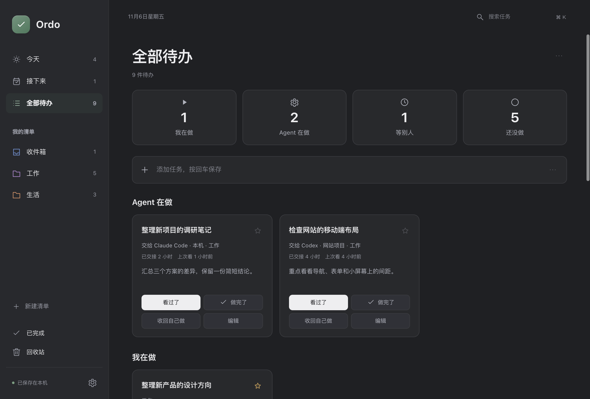

<p align="center">
  
</p>

<h1 align="center">Ordo · 序</h1>

<p align="center"><strong>每件事，都有着落。</strong></p>
<p align="center">一款简洁的 Mac 待办应用。<br/>我在做、Agent 在做、等别人、还没做，一眼看清。</p>

<p align="center">macOS 13.5+ · Apple Silicon · 本地存储 · MIT 开源</p>
<p align="center">
  <a href="#开始使用">开始使用</a> ·
  <a href="#交出去的事也记得跟进">Agent 跟进</a> ·
  <a href="docs/development.md">构建指南</a> ·
  <a href="docs/data-and-backup.md">数据与备份</a>
</p>


## 打开就知道，下一步做什么

不用先规划一套复杂的系统。记下任务，按回车保存；开始做时点一下，做完再点一下。顶部四种状态展示数量，也可以直接筛选。卡片按状态排列，标题、说明和下一步操作都在眼前。

- **我在做**：当前投入的事，随时完成或转为等待。
- **Agent 在做**：手动记录交接位置、要求和查看时间。
- **等别人**：写清在等什么，有了回应就继续做。
- **还没做**：先记下来，准备好了再开始。

## 交出去的事，也记得跟进

任务可以记在「Agent 在做」里，例如交给了 Claude Code、Codex，或某台服务器上的工具。填好位置和交接说明，卡片就会显示已交接多久、上次何时查看；长时间未查看时出现跟进提示。

**看过了**更新查看时间，**收回自己做**切换回自己的工作，**做完了**结束任务。误操作可以撤销。

这是手动跟进分类。当前版本不会连接、调用或启动 Codex，也不需要安装任何 Agent。

## 简单开始，需要时再展开

「今天」集中当天与逾期任务，「接下来」查看未来安排，「全部待办」看到整体。工作、生活和个人项目可以各有自己的清单。

标题、状态、日期和备注直接可见；步骤按需添加，重复规则与标签收在「更多选项」里。已有任务的信息会保留。


## 顺手，也安心

| 日常操作 | Ordo 的做法 |
| --- | --- |
| 快速记录 | 顶部输入后回车；今天和接下来视图自动安排日期 |
| 找回任务 | 全局搜索覆盖标题、备注、标签、步骤和清单 |
| 整理清单 | 拖动卡片移动；右上角菜单提供排序和多选 |
| 重复待办 | 按星期重复，支持每天完成与自定义重置时间 |
| 避免误操作 | 完成、状态切换与删除可撤销；回收站可恢复 |
| 外观与动效 | 浅色、深色、跟随系统；支持减少动态效果 |
| 本地保存 | 修改自动保存；支持 JSON 导出和完整数据库备份 |

<details>
<summary>查看深色外观</summary>



</details>

## 开始使用

当前版本 **2.2.0**。本仓库提供源码，可在 Mac 上构建应用。已验证 Apple Silicon；使用 Node.js 24 的构建要求 macOS 13.5 或更新版本。

安装 Xcode Command Line Tools 与 Node.js 24+ 后：

```sh
git clone https://github.com/zs1314/Ordo.git
cd Ordo
ORDO_NODE="$(command -v node)" ORDO_OUTPUT="$PWD/dist/Ordo.app" bash build.sh
open dist
```

将生成的 `Ordo.app` 拖入「应用程序」，通过 Spotlight 或启动台打开。应用内置 Node.js，运行时不需要另外安装 Node.js。

构建脚本使用本机 ad-hoc 签名；目前没有 Apple Developer ID 签名或公证，未验证 Intel Mac。环境要求、测试与项目结构见[构建指南](docs/development.md)。

### 常用快捷键

| 快捷键 | 操作 |
| --- | --- |
| `⌘ N` | 打开新建任务详情 |
| `⌘ ↵` | 保存任务 |
| `⌘ F` / `⌘ K` | 全局搜索 |
| `⌘ ,` | 打开设置 |
| `⌘ Q` | 完全退出应用 |

## 数据留在自己手中

无需注册，待办操作可以离线完成。任务和设置保存在本机 SQLite 中，更新应用不会清空数据。导出与恢复方法见[数据与备份](docs/data-and-backup.md)。

目前没有云同步或系统到期通知；重复任务的每日重置时间用于打卡计算。

## 许可

项目采用 [MIT License](LICENSE)。第三方组件及其许可见[构建指南](docs/development.md#第三方许可)。Ordo 是独立项目，与 Apple、OpenAI 无隶属关系。

<sub>截图使用演示任务。已完成的测试见 <a href="VALIDATION.md">版本验证记录</a>。</sub>
