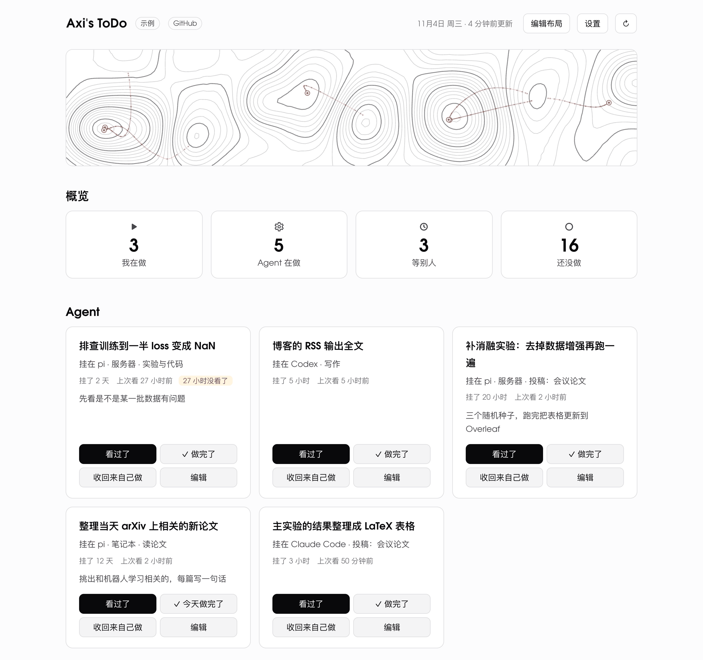

# ToDo

A self-hosted to-do board for one person and the AI agents they hand work to.

**[Live demo](https://todo.axi404.top)** (made-up data; your changes stay in your browser)



Besides to do, doing, waiting, done and dropped, an item can be handed to an agent. The board then records where the agent runs, since when, and when you last checked on it; it lists these items at the top, least recently checked first, and flags the ones you have not looked at for a while.

The interface is in Chinese.

## Features

- Sections, cards and items that you arrange on the page; inline Markdown in titles and notes
- Recurring items with daily check-ins, streaks, and an optional time at which their day rolls over
- Due dates, including AoE, and a month calendar
- Done items stay in their card for a few days, then fold away; a chart of what got done (two weeks of bars, or a heatmap)
- Effects when something is done or checked in, and animations in the header; all optional, and off when the system asks for reduced motion
- Appearance settings: light or dark, font, size, width, density, layout, custom CSS
- An optional password, and optional sync of assignments from Canvas LMS
- A JSON API, and a small client (`client.mjs`) for agents and scripts
- Works on phones

The server uses only Node's standard library, including its built-in SQLite. The frontend is [Preact](https://preactjs.com/) with [htm](https://github.com/developit/htm), loaded as plain ES modules: nothing to install, nothing to build.

## Run it

Needs Node 24 or later.

```sh
git clone https://github.com/Axi404/todo.git
cd todo
node server.mjs
```

Then open http://127.0.0.1:4404. The data goes to `./data/todo.db`.

| Variable | Default | |
|---|---|---|
| `TODO_DIR` | `./data` | data directory |
| `TODO_PORT` | `4404` | port; the server listens on 127.0.0.1 only |
| `TODO_PUBLIC_HOST` | | the host name behind a reverse proxy, e.g. `todo.example.com`; requests for other hosts, and changes sent from other sites, are refused |
| `TODO_PASSWORD`, `TODO_SECRET` | | ask for a password; the secret signs the login cookie |
| `CANVAS_HOST`, `CANVAS_TOKEN` | | sync assignments from Canvas every three hours |
| `TZ` | the system's | what "today" means when an agent checks an item in |

## Data

Everything is in one SQLite file in the data directory, `todo.db`: the board, a log with one entry per change saying what changed and who changed it, and the state of the Canvas sync. `data.mjs` reads and writes it from the command line, in the same `TODO_DIR`:

| | |
|---|---|
| `node data.mjs export` | the board as JSON, as `GET /api/todo` returns it |
| `node data.mjs import <board.json> [--log <log.jsonl>] [--replace]` | load a board, and its log if given (without `--log` the log stays as it is); a board that already has items is only replaced with `--replace` |
| `node data.mjs markdown` | the board as Markdown |
| `node data.mjs log` | the log, one JSON line per change |

Run it as the user the server runs as, so the files SQLite creates next to `todo.db` stay writable for the server.

To back up, export the board and the log, or make a consistent copy of the whole database, which works while the server runs: `sqlite3 data/todo.db "VACUUM INTO 'backup.db'"`. Copying `todo.db` itself is not enough while the server runs: the latest changes may still be in `todo.db-wal` next to it.

## API

`GET /api/todo` returns the board. Changes are the `POST`, `PATCH` and `DELETE` requests listed in [core/edits.mjs](core/edits.mjs); each returns the updated board. Programs say who they are with an `X-Actor` header, which goes into the log, and send `Authorization: Bearer <password>` if the board has one.

`client.mjs` wraps this for agents and scripts:

```js
import { createClient } from "./client.mjs";

const todo = createClient({ url: "https://todo.example.com", passwordFile: "/path/to/password", actor: "agent" });
console.log(await todo.status());                                  // a plain-text summary of the board
await todo.set({ item: "weekly report", status: "agent", where: "my laptop" });
await todo.add({ group: "work", title: "Read the review" });
```

## Canvas

With `CANVAS_HOST` (for example `canvas.instructure.com`) and an access token in `CANVAS_TOKEN`, the server reads your courses' assignments every three hours, and whenever you press the sync button. Assignments that are still open become items with their due dates, in a card you choose in the settings. Submitted ones are marked done. Your own edits are never overwritten, and items you delete are not imported again. The board only reads from Canvas, never writes.

## Demo site

`node demo/build.mjs <dir>` writes a static copy of the board with made-up data. It runs entirely in the browser: no server, no requests, and changes are gone after a reload. The [live demo](https://todo.axi404.top) is built this way.

## Deploying

`deploy/` installs the board on a Debian or Ubuntu server with nginx, over ssh. Copy `deploy/deploy.env.example` to `deploy/deploy.env` and fill it in. Then run `zsh deploy/setup.sh` once, and `zsh deploy/deploy.sh` for every release. Each release goes into a directory of its own and is rolled back if it does not start. The service runs as its own user with read-only code, and nginx gets a Let's Encrypt certificate. `zsh deploy/demo.sh setup`, then `zsh deploy/demo.sh`, does the same for the demo site.

## Development

- `node --test test/*.test.mjs`: the data layer and its storage, the API, login, the client
- `node dev/test-board.mjs`, `dev/test-heroes.mjs`, `dev/test-demo.mjs`, `dev/test-canvas-sync.mjs`: checks that drive a headless Chrome (set `CHROME` if it is not where macOS puts it)
- `node dev/snapshot.mjs`: screenshots and page structure, compared before and after a change that should not change how the board looks

| | |
|---|---|
| `server.mjs`, `server/` | HTTP: host and origin checks, login, static files, the API |
| `core/` | the data layer: storage, items, cards and sections, places, the Markdown copy |
| `data.mjs` | the data on the command line: export, import, Markdown, the log |
| `web/` | the frontend; header animations in `web/lib/heroes/` (see its README), effects in `web/lib/fx/` |
| `canvas/`, `canvas-sync.mjs` | Canvas sync |
| `client.mjs` | the API client |
| `demo/` | the demo site |
| `deploy/` | deployment |
| `dev/`, `test/` | checks |

## License

[MIT](LICENSE). The third-party code and font included here keep their own licenses: Preact (MIT) and htm (Apache-2.0) in [web/vendor/](web/vendor/), and the Adventor Todo font (GUST Font License) in [web/fonts/](web/fonts/).
